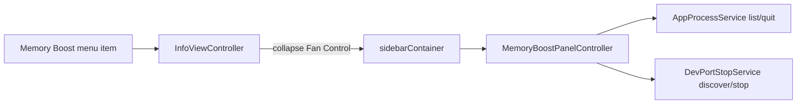

# Memory Boost apps sidebar

Status: implemented

## Next agent turn (start here)

**Feature complete.** No further phases.

**Context:** All work uncommitted unless asked: `Hot/Classes/MemoryBoost/`, `Scripts/test-app-process.swift`, InfoViewController sidebar mutual exclusion, ApplicationDelegate menu → sidebar, MainMenu title, pbxproj, README. Scripts OK (dev-port 7 + app-process 5); MemoryBoost+DevPorts typecheck OK. Full `xcodebuild` Release still blocked by pre-existing SMCKit `kIOMasterPortDefault` `-Werror` (out of scope). Do not commit unless asked. Do not reopen Vorssaint.

**Already shipped:** phases 1–4.

## Locked choices

- **List:** user GUI apps only (`NSRunningApplication`, `.regular`), sorted by resident memory descending; each row Quit (Option-click = Force Quit).
- **Same panel:** keep Dev-ports “Stop all listeners” section (reuse [`DevPortStopService`](../../Hot/Classes/DevPorts/DevPortStopService.swift)).
- **Surface:** status-menu sidebar like Fan Control — **not** a separate window.
- **Sidebar shell:** reuse the existing shell in [`InfoViewController`](../../Hot/Classes/InfoViewController.swift); Memory Boost and Fan Control are **mutually exclusive** (opening one collapses the other). Avoid dual-expand / double width.

## Out of scope

Full process browser (CLI/daemons), privileged helper, Activity Monitor clone, `purge`, SMCKit SDK fix, Vorssaint.

## Architecture



## Phases / shipped

| Phase | Deliverable | Status |
|---|---|---|
| 1 | `AppProcessService` (+ shared safe-quit helpers): list regular apps + memory, protect Hot/system, Quit/Force Quit with start-time identity; script tests | done |
| 2 | `MemoryBoostPanelController`: scrollable app rows + Quit; Dev-ports section + Stop All; refresh while visible | done |
| 3 | Wire sidebar in `InfoViewController` (mutual exclusion with Fan Control); menu item opens Memory Boost sidebar (alerts become in-panel feedback) | done |
| 4 | README update + verify; Status → implemented | done |

## Implementation notes

- **Memory:** `proc_pidinfo` / `PROC_PIDTASKINFO` (`pti_resident_size`) per PID; skip if unavailable.
- **Quit path:** prefer `NSRunningApplication.terminate()` / `forceTerminate()` for `.regular` apps; re-check start-time identity before signal.
- **Protected:** reuse [`DevPortSupport.isProtected`](../../Hot/Classes/DevPorts/DevPortSupport.swift); never list Hot as killable.
- **UI:** compact AppKit (stack + scroll view), match Fan Control sidebar density; refresh on open + light timer while expanded.
- **Menu:** **Memory Boost…** expands Memory Boost sidebar (reopens status menu after item dismisses); Dev-port bulk stop is in-panel.
- **pbxproj:** `Hot/Classes/MemoryBoost/`.

## Verify

```sh
cd /Volumes/Projects/Projects/Hot
swift Scripts/test-dev-port-stop.swift
swift Scripts/test-app-process.swift
swiftc -typecheck -sdk "$(xcrun --show-sdk-path --sdk macosx)" -target arm64-apple-macos12.0 \
  Hot/Classes/DevPorts/DevPortSupport.swift Hot/Classes/DevPorts/DevPortStopService.swift \
  Hot/Classes/MemoryBoost/AppProcessSupport.swift Hot/Classes/MemoryBoost/AppProcessService.swift \
  Hot/Classes/MemoryBoost/MemoryBoostPanelController.swift
# Manual: status menu → Memory Boost… → apps list + Quit; Stop all listeners in panel; Fan Control expand collapses Memory Boost
```

## Session log

- 2026-10-19: User asked for richer Memory Boost (app list + kill). Locked: GUI apps by memory + Dev-ports Stop All; Fan Control–style status-menu sidebar (mutual exclusion with Fan Control shell).
- 2026-10-19: User asked to finish all phases. Shipped 1–4: `AppProcessSupport`/`AppProcessService` + `test-app-process.swift` (5 OK); `MemoryBoostPanelController`; InfoViewController `SidebarMode` mutual exclusion; menu → sidebar (async status-menu reopen); README Memory Boost section; pbxproj MemoryBoost group. Typecheck OK. Status → implemented.
- 2026-10-19: UI polish — full scrollable Dev-port listener list (no “+N more”); clarify Stop All quits processes on Dev ports; card rows, section pills, status pill. Relunched Release `/Applications/Hot.app`.
- 2026-10-19: Empty apps list bug — `NSWorkspace.runningApplications` was queried off the main thread (returns []); fixed list on main, scroll document layout, keep apps when memory probe fails. Antigravity IDE is `.regular` and should now appear.
